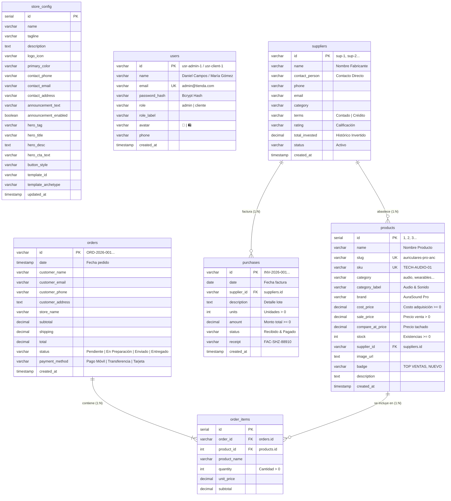
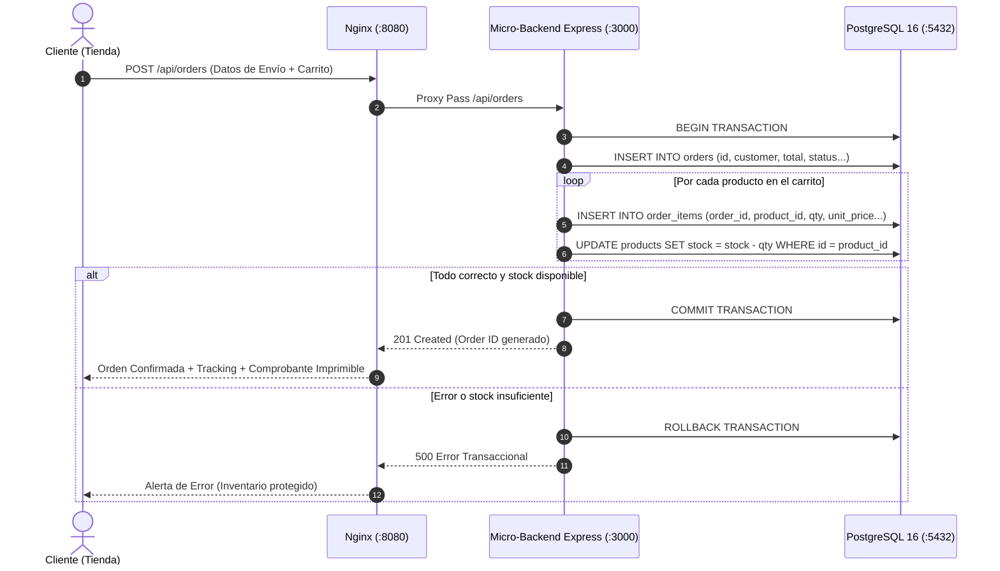
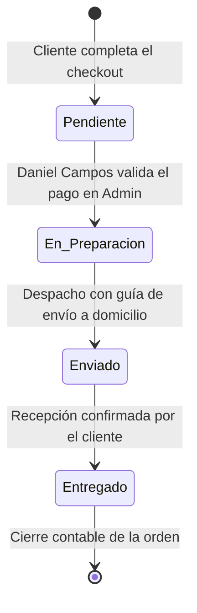

# 🗄️ ARQUITECTURA Y MODELADO DE BASE DE DATOS RELACIONAL POSTGRESQL 16
## Plataforma E-Commerce Oficial & Backoffice Administrativo
**Responsable & Administrador del Sistema:** Daniel Campos  
**Proyecto:** Sistema de Comercio Electrónico Multi-Arquetipo y Gestión Backoffice  
**Motor de Persistencia:** PostgreSQL 16.15 (Alpine Linux)  
**Entorno de Despliegue:** Docker Compose Multi-Contenedor (Red Bridge `ecommerce_network`)  
**Fecha de Documentación:** Octubre 2026  

---

## 📋 1. Ficha Técnica y Resumen Ejecutivo

| Parámetro | Especificación Técnica | Justificación de Ingeniería |
| :--- | :--- | :--- |
| **Motor RDBMS** | PostgreSQL 16 (Oficial) | Máximo estándar de la industria en integridad transaccional ACID, soporte relacional estricto y alto rendimiento. |
| **Nombre de Base de Datos** | `ecommerce_db` | Base de datos unificada para catálogo, usuarios, finanzas y operaciones. |
| **Usuario DBA / Admin** | `daniel_admin` | Rol de superusuario para operaciones administrativas y conexión de servicios. |
| **Puerto Expuesto** | `5432:5432` | Acceso directo para herramientas de análisis (DBeaver, pgAdmin, CLI psql). |
| **Estrategia de Persistencia** | Volumen Docker `ecommerce_postgres_data` | Durabilidad física en el disco del host que garantiza cero pérdida de datos ante reinicio de contenedores. |
| **Arquitectura de Conexión** | Connection Pool (`pg.Pool`, máx. 20 conexiones) | Reutilización eficiente de hilos concurrentes, previniendo sobrecarga en CPU y memoria. |
| **Forma Normal** | 3FN (Tercera Forma Normal) | Eliminación de redundancias, garantías de integridad referencial y prevención de anomalías de actualización. |

---

## 🏛️ 2. Diagramas de Arquitectura y Modelado

### 2.1 Diagrama Entidad-Relación Completo (ERD)

El siguiente diagrama detalla las 7 tablas del sistema, sus campos, tipos de datos, claves primarias (**PK**), claves foráneas (**FK**), restricciones de unicidad (**UK**) y sus relaciones cardinales:



---

### 2.2 Topología Multi-Contenedor en Docker Compose

El sistema opera bajo un esquema desacoplado de **3 capas (3-Tier Enterprise)** interconectadas por la red interna puente `ecommerce_network`:

```mermaid
graph TD
    Client["Navegador Web / Dispositivo Móvil<br/>(Daniel Campos / Jurado Evaluador)"]
    
    subgraph HostDocker["Máquina Host (Windows WSL / Linux Server)"]
        subgraph BridgeNet["Red Docker Bridge: ecommerce_network"]
            Nginx["<b>Servicio 1: web (Nginx 1.25 Alpine)</b><br/>• Puerto Público: 8080:80<br/>• Servidor de Assets (HTML, CSS, JS)<br/>• Proxy Inverso /api/ -> api:3000<br/>• Cabeceras de Seguridad y Gzip"]
            
            NodeAPI["<b>Servicio 2: api (Node.js 20 Alpine)</b><br/>• Puerto Interno: 3000<br/>• Micro-Backend Express REST<br/>• Connection Pooling pg (20 clientes)<br/>• Validación y Lógica Transaccional"]
            
            Postgres["<b>Servicio 3: db (PostgreSQL 16 Alpine)</b><br/>• Puerto Mapeado: 5432:5432<br/>• Motor Relacional Transaccional ACID<br/>• DDL Inicial: database/init.sql<br/>• Vistas SQL & Restricciones"]
        end
        
        DiskVolume[("<b>Volumen Persistente Host</b><br/>ecommerce_postgres_data<br/>(/var/lib/postgresql/data)")]
    end
    
    Client -->|HTTP :8080 / UI & Admin| Nginx
    Nginx -->|Proxy /api/*| NodeAPI
    NodeAPI -->|Pool de Conexiones SQL| Postgres
    Postgres -->|Persistencia en Disco| DiskVolume
    Client -.->|Acceso Directo psql / DBeaver (:5432)| Postgres
```

---

### 2.3 Diagrama de Flujo Transaccional de Venta (Checkout Atómico)

Cada orden de compra que se realiza en la tienda pública ejecuta una transacción atómica protegida por **ACID**:



---

### 2.4 Máquina de Estados del Pedido (`orders.status`)

El ciclo de vida del pedido cumple con una máquina de estados estricta verificada por la restricción `CHECK (status IN ('Pendiente', 'En Preparación', 'Enviado', 'Entregado'))`:



---

## 📖 3. Diccionario de Datos Relacional Exhaustivo

### 3.1 Tabla: `store_config` (Configuración y Branding)
Almacena la identidad corporativa de la tienda, paletas de colores, textos del banner de anuncios y el arquetipo visual activo.

| Columna | Tipo de Dato | Nulo | Por Defecto | Descripción |
| :--- | :--- | :---: | :--- | :--- |
| `id` | `SERIAL` | **NO** | `nextval()` | Clave primaria autoincremental única. |
| `name` | `VARCHAR(150)` | **NO** | `'Mi Tienda Oficial'` | Nombre comercial de la empresa. |
| `tagline` | `VARCHAR(200)` | SÍ | `'Tecnología, Accesorios...'` | Eslogan comercial de la cabecera. |
| `description` | `TEXT` | SÍ | `NULL` | Descripción corporativa oficial. |
| `logo_icon` | `VARCHAR(20)` | SÍ | `'🛍️'` | Emoji o identificador visual de logotipo. |
| `primary_color` | `VARCHAR(20)` | SÍ | `'#2563eb'` | Código hexadecimal de color de marca principal. |
| `contact_phone` | `VARCHAR(50)` | SÍ | `'+58 414 123 4567'` | Línea de atención telefónica / WhatsApp. |
| `contact_email` | `VARCHAR(120)` | SÍ | `'contacto@mitienda.com'` | Correo corporativo de atención. |
| `contact_address` | `VARCHAR(255)` | SÍ | `'Av. Principal Comercial...'` | Dirección física de la sede o almacén. |
| `announcement_text` | `VARCHAR(255)` | SÍ | `'Catálogo oficial...'` | Texto del cintillo superior promocional. |
| `announcement_enabled`| `BOOLEAN` | SÍ | `TRUE` | Estado de visualización del banner. |
| `hero_tag` | `VARCHAR(100)` | SÍ | `'Colección Oficial 2026'` | Píldora de lanzamiento en la portada. |
| `hero_title` | `VARCHAR(200)` | SÍ | `'Productos Exclusivos...'` | Título principal H1 del Hero Section. |
| `hero_desc` | `TEXT` | SÍ | `NULL` | Párrafo explicativo del Hero Section. |
| `hero_cta_text` | `VARCHAR(80)` | SÍ | `'Explorar Catálogo'` | Texto del botón de llamado a la acción. |
| `button_style` | `VARCHAR(30)` | SÍ | `'pill'` | Estilo de bordes (`pill`, `rounded`, `sharp`). |
| `template_id` | `VARCHAR(50)` | SÍ | `'moderno-tech'` | Identificador de plantilla activa. |
| `template_archetype` | `VARCHAR(50)` | SÍ | `'moderno'` | Arquetipo estructural CSS asociado. |
| `updated_at` | `TIMESTAMP` | SÍ | `CURRENT_TIMESTAMP` | Fecha y hora de la última modificación. |

---

### 3.2 Tabla: `users` (Usuarios, Roles y Control de Acceso RBAC)
Gestiona la seguridad y el acceso segregado entre el Dueño/Administrador (**Daniel Campos**) y los clientes compradores.

| Columna | Tipo de Dato | Nulo | Restricciones / Claves | Descripción |
| :--- | :--- | :---: | :--- | :--- |
| `id` | `VARCHAR(50)` | **NO** | `PRIMARY KEY` | Identificador único (`usr-admin-1`, `usr-client-1`). |
| `name` | `VARCHAR(150)` | **NO** | - | Nombre completo del usuario registrado. |
| `email` | `VARCHAR(150)` | **NO** | `UNIQUE` | Correo electrónico de inicio de sesión. |
| `password_hash` | `VARCHAR(255)` | **NO** | - | Hash criptográfico seguro de la contraseña. |
| `role` | `VARCHAR(20)` | **NO** | `CHECK (role IN ('admin','cliente'))` | Rol en el sistema para control de acceso (RBAC). |
| `role_label` | `VARCHAR(100)` | **NO** | - | Etiqueta visible del rol (`Administrador / Dueño`). |
| `avatar` | `VARCHAR(20)` | SÍ | `DEFAULT '👤'` | Icono o avatar visual del usuario. |
| `phone` | `VARCHAR(50)` | SÍ | - | Teléfono móvil del usuario. |
| `created_at` | `TIMESTAMP` | SÍ | `DEFAULT CURRENT_TIMESTAMP` | Fecha de creación del registro. |

---

### 3.3 Tabla: `suppliers` (Proveedores Comerciales y Distribuidores)
Registra las casas matrices, fabricantes e importadores que suministran la mercancía del catálogo.

| Columna | Tipo de Dato | Nulo | Claves | Descripción |
| :--- | :--- | :---: | :--- | :--- |
| `id` | `VARCHAR(50)` | **NO** | `PRIMARY KEY` | Código único de proveedor (`sup-1`, `sup-2`). |
| `name` | `VARCHAR(200)` | **NO** | - | Razón social o nombre comercial de la empresa proveedora. |
| `contact_person` | `VARCHAR(150)` | **NO** | - | Nombre del representante de ventas o ejecutivo de cuenta. |
| `phone` | `VARCHAR(50)` | SÍ | - | Teléfono de contacto comercial internacional o local. |
| `email` | `VARCHAR(150)` | SÍ | - | Correo electrónico de recepción de órdenes de compra. |
| `category` | `VARCHAR(100)` | SÍ | - | Línea o rubro comercial principal (`Audio`, `Wearables`). |
| `terms` | `VARCHAR(100)` | SÍ | `DEFAULT 'Contado'` | Condiciones de pago (`Crédito 15 días`, `Transferencia`). |
| `rating` | `VARCHAR(50)` | SÍ | `DEFAULT '4.9 ★'` | Evaluación de cumplimiento y calidad de entrega. |
| `total_invested` | `DECIMAL(12,2)` | SÍ | `DEFAULT 0.00` | Monto acumulado histórico comprado a este proveedor. |
| `status` | `VARCHAR(30)` | SÍ | `DEFAULT 'Activo'` | Estado operativo del proveedor en el sistema. |
| `created_at` | `TIMESTAMP` | SÍ | `DEFAULT CURRENT_TIMESTAMP` | Fecha de alta del proveedor. |

---

### 3.4 Tabla: `products` (Catálogo Maestro y Control de Inventario)
Contiene la ficha técnica de cada artículo, precios de adquisición, precio al público y control de existencias en almacén.

| Columna | Tipo de Dato | Nulo | Restricciones / Claves | Descripción |
| :--- | :--- | :---: | :--- | :--- |
| `id` | `SERIAL` | **NO** | `PRIMARY KEY` | Identificador único secuencial del producto. |
| `name` | `VARCHAR(200)` | **NO** | - | Nombre comercial completo del producto. |
| `slug` | `VARCHAR(200)` | **NO** | `UNIQUE` | Cadena legible para URL amigable. |
| `sku` | `VARCHAR(60)` | **NO** | `UNIQUE` | Stock Keeping Unit (Código único de inventario). |
| `category` | `VARCHAR(50)` | **NO** | - | Identificador de categoría (`audio`, `wearables`, etc.). |
| `category_label` | `VARCHAR(100)` | **NO** | - | Nombre visible de categoría (`Audio & Sonido`). |
| `brand` | `VARCHAR(100)` | SÍ | - | Marca del fabricante (`AuraSound Pro`, `Apex Watch`). |
| `cost_price` | `DECIMAL(10,2)` | **NO** | `CHECK (cost_price >= 0)` | Costo unitario de compra / adquisición. |
| `sale_price` | `DECIMAL(10,2)` | **NO** | `CHECK (sale_price > 0)` | Precio de venta final para el cliente. |
| `compare_at_price`| `DECIMAL(10,2)` | SÍ | - | Precio tachado para destacar descuento. |
| `stock` | `INT` | **NO** | `CHECK (stock >= 0)` | Cantidad física de unidades disponibles en almacén. |
| `supplier_id` | `VARCHAR(50)` | SÍ | `REFERENCES suppliers(id) ON DELETE SET NULL` | Clave foránea al proveedor que lo fabrica. |
| `image_url` | `TEXT` | **NO** | - | Ruta relativa o URL de la fotografía de alta resolución. |
| `badge` | `VARCHAR(50)` | SÍ | - | Distintivo promocional (`TOP VENTAS`, `NUEVO DROP`). |
| `description` | `TEXT` | SÍ | - | Descripción detallada de especificaciones técnicas. |
| `created_at` | `TIMESTAMP` | SÍ | `DEFAULT CURRENT_TIMESTAMP` | Fecha de creación del registro en base de datos. |

---

### 3.5 Tabla: `purchases` (Facturas de Abastecimiento de Mercancía)
Registra las compras de lotes de reposición para alimentar el inventario y mantener la trazabilidad de costos.

| Columna | Tipo de Dato | Nulo | Restricciones / Claves | Descripción |
| :--- | :--- | :---: | :--- | :--- |
| `id` | `VARCHAR(50)` | **NO** | `PRIMARY KEY` | Número de factura o lote (`INV-2026-001`). |
| `date` | `DATE` | **NO** | - | Fecha de emisión de la orden de compra. |
| `supplier_id` | `VARCHAR(50)` | SÍ | `REFERENCES suppliers(id) ON DELETE CASCADE` | Proveedor al que se le realizó la orden. |
| `description` | `TEXT` | **NO** | - | Descripción del lote (`50x Auriculares + 60x Altavoces`). |
| `units` | `INT` | **NO** | `CHECK (units > 0)` | Total de piezas físicas recibidas en el lote. |
| `amount` | `DECIMAL(12,2)` | **NO** | `CHECK (amount >= 0)` | Inversión total en USD pagada al proveedor. |
| `status` | `VARCHAR(50)` | SÍ | `DEFAULT 'Recibido & Pagado'` | Estado administrativo del despacho del lote. |
| `receipt` | `VARCHAR(80)` | SÍ | - | Número de comprobante o factura fiscal física. |
| `created_at` | `TIMESTAMP` | SÍ | `DEFAULT CURRENT_TIMESTAMP` | Registro en el sistema contable. |

---

### 3.6 Tabla: `orders` (Maestro de Órdenes de Clientes)
Almacena cada pedido procesado en la tienda, datos de contacto del cliente, dirección de entrega y montos consolidados.

| Columna | Tipo de Dato | Nulo | Restricciones / Claves | Descripción |
| :--- | :--- | :---: | :--- | :--- |
| `id` | `VARCHAR(50)` | **NO** | `PRIMARY KEY` | Código único de seguimiento del pedido (`ORD-2026-001`). |
| `date` | `TIMESTAMP` | SÍ | `DEFAULT CURRENT_TIMESTAMP` | Fecha y hora exacta de la compra. |
| `customer_name` | `VARCHAR(150)` | **NO** | - | Nombre completo del comprador. |
| `customer_email`| `VARCHAR(150)` | **NO** | - | Correo del cliente para confirmación y factura. |
| `customer_phone`| `VARCHAR(50)` | SÍ | - | Teléfono para coordinación del despacho. |
| `customer_address`| `TEXT` | SÍ | - | Dirección física detallada de destino. |
| `store_name` | `VARCHAR(150)` | SÍ | `'Mi Tienda Oficial'` | Sucursal comercial donde se procesó la venta. |
| `subtotal` | `DECIMAL(10,2)` | **NO** | - | Suma de los subtotales de productos. |
| `shipping` | `DECIMAL(10,2)` | SÍ | `DEFAULT 0.00` | Costo de flete ($0.00 si aplicó envío gratis). |
| `total` | `DECIMAL(10,2)` | **NO** | - | Importe neto total facturado al cliente. |
| `status` | `VARCHAR(30)` | SÍ | `CHECK (status IN ('Pendiente','En Preparación','Enviado','Entregado'))` | Estado del pedido en la máquina de despacho. |
| `payment_method`| `VARCHAR(80)` | SÍ | `DEFAULT 'Pago Móvil'` | Canal de pago (`Pago Móvil`, `Transferencia`, `Zelle`). |
| `created_at` | `TIMESTAMP` | SÍ | `DEFAULT CURRENT_TIMESTAMP` | Marca temporal del registro. |

---

### 3.7 Tabla: `order_items` (Detalle de Líneas de Factura)
Tabla relacional que desglosa los artículos adquiridos en cada orden, garantizando la relación `1:N` entre `orders` y `products`.

| Columna | Tipo de Dato | Nulo | Restricciones / Claves | Descripción |
| :--- | :--- | :---: | :--- | :--- |
| `id` | `SERIAL` | **NO** | `PRIMARY KEY` | Identificador autoincremental de la línea. |
| `order_id` | `VARCHAR(50)` | SÍ | `REFERENCES orders(id) ON DELETE CASCADE` | Enlace a la orden de compra maestra. |
| `product_id` | `INT` | SÍ | `REFERENCES products(id) ON DELETE SET NULL` | Enlace al producto del catálogo. |
| `product_name` | `VARCHAR(200)` | **NO** | - | Nombre histórico del producto congelado al vender. |
| `quantity` | `INT` | **NO** | `CHECK (quantity > 0)` | Unidades adquiridas de este producto. |
| `unit_price` | `DECIMAL(10,2)` | **NO** | - | Precio unitario congelado en el momento de la venta. |
| `subtotal` | `DECIMAL(10,2)` | **NO** | - | `quantity * unit_price`. |

---

## 📊 4. Vistas Analíticas e Inteligencia de Negocio

### 4.1 Vista SQL: `v_inventory_financials`
Esta vista analítica permite al panel de administración calcular márgenes de rentabilidad brutos y proyecciones de ganancia sin saturar la aplicación con cálculos manuales:

```sql
CREATE OR REPLACE VIEW v_inventory_financials AS
SELECT 
    p.id,
    p.sku,
    p.name,
    p.category_label,
    s.name AS supplier_name,
    p.cost_price,
    p.sale_price,
    (p.sale_price - p.cost_price) AS unit_profit,
    ROUND(((p.sale_price - p.cost_price) / p.sale_price) * 100, 2) AS margin_percentage,
    p.stock,
    (p.cost_price * p.stock) AS total_inventory_cost,
    (p.sale_price * p.stock) AS total_inventory_revenue,
    ((p.sale_price - p.cost_price) * p.stock) AS projected_total_profit
FROM products p
LEFT JOIN suppliers s ON p.supplier_id = s.id;
```

#### Métricas Calculadas en Tiempo Real:
1. **Ganancia Unitaria (`unit_profit`)**: Margen bruto nominal por cada unidad vendida (`sale_price - cost_price`).
2. **Margen Porcentual (`margin_percentage`)**: Retorno porcentual sobre el precio de venta al público.
3. **Costo Total Inmovilizado (`total_inventory_cost`)**: Capital total invertido en almacén (`cost_price * stock`).
4. **Valoración Comercial Total (`total_inventory_revenue`)**: Ingresos brutos potenciales si se liquida el inventario.
5. **Utilidad Bruta Proyectada (`projected_total_profit`)**: Ganancia neta proyectada al vender la totalidad del stock.

---

## ⚡ 5. Estrategia de Indexación y Optimización de Consultas

Se crearon índices **B-Tree** sobre los campos con mayor frecuencia de filtrado y búsqueda, reduciendo la complejidad de consulta de $O(N)$ a $O(\log N)$:

| Nombre del Índice | Tabla | Columna Indexada | Tipo | Razón de Optimización |
| :--- | :--- | :--- | :---: | :--- |
| `idx_products_sku` | `products` | `sku` | B-Tree | Búsqueda instantánea de mercancía por escáner de código de barras. |
| `idx_products_category`| `products` | `category` | B-Tree | Filtrado acelerado en la tienda al hacer clic en categorías de la barra de navegación. |
| `idx_orders_status` | `orders` | `status` | B-Tree | Segmentación rápida en el panel administrativo por pedidos pendientes o enviados. |
| `idx_orders_date` | `orders` | `date` | B-Tree | Generación ágil de reportes contables mensuales y gráficos de ventas cronológicos. |
| `idx_users_email` | `users` | `email` | B-Tree | Validación de credenciales en microsegundos durante el proceso de login. |

---

## 🛡️ 6. Cumplimiento de las Propiedades ACID en PostgreSQL

| Propiedad | Mecanismo en la Base de Datos | Ejemplo en el Proyecto |
| :--- | :--- | :--- |
| **Atomicidad (A)** | Transacciones explícitas (`BEGIN ... COMMIT / ROLLBACK`). | Al crear una orden, si falla la inserción de una línea de producto o el decremento de stock, toda la orden se revierte para no dejar registros huérfanos. |
| **Consistencia (C)** | Restricciones `CHECK`, claves foráneas `FOREIGN KEY` y unicidad `UNIQUE`. | Imposible registrar un producto con precio negativo (`CHECK sale_price > 0`) o con un SKU duplicado. |
| **Aislamiento (I)** | Nivel de aislamiento estándar `READ COMMITTED` con bloqueo a nivel de fila (*Row-Level Locking*). | Si dos clientes compran simultáneamente el último producto en stock, PostgreSQL procesa una transacción tras otra sin sobre-vender inventario. |
| **Durabilidad (D)** | WAL (*Write-Ahead Logging*) + Volumen persistente `ecommerce_postgres_data`. | Aunque se apague la computadora o se reinicie el contenedor de Docker, todas las transacciones confirmadas están escritas en disco y no se pierden. |

---

## 💻 7. Guía Rápida de Consultas SQL para la Defensa Académica

Durante la defensa ante los profesores, Daniel Campos puede abrir la terminal interactiva de PostgreSQL y ejecutar estas consultas de demostración en vivo:

### Consulta 1: Conexión y Salud de la Base de Datos
```bash
wsl docker exec -it ecommerce_postgres_db psql -U daniel_admin -d ecommerce_db -c "SELECT version(), current_database(), current_user;"
```

### Consulta 2: Resumen Ejecutivo del Catálogo con Proveedores
```sql
SELECT 
    p.id, 
    p.sku, 
    p.name, 
    p.sale_price, 
    p.stock, 
    s.name AS proveedor
FROM products p
LEFT JOIN suppliers s ON p.supplier_id = s.id
ORDER BY p.id ASC;
```

### Consulta 3: Auditoría de Rentabilidad y Ganancias del Inventario
```sql
SELECT 
    name, 
    cost_price, 
    sale_price, 
    unit_profit, 
    margin_percentage || '%' AS margen, 
    stock, 
    projected_total_profit AS ganancia_potencial
FROM v_inventory_financials
ORDER BY projected_total_profit DESC;
```

### Consulta 4: Consulta de Órdenes y Totales de Venta
```sql
SELECT 
    id, 
    customer_name, 
    total, 
    status, 
    payment_method, 
    date 
FROM orders 
ORDER BY date DESC;
```

---

## 🎯 8. Conclusión

El diseño de la base de datos de esta plataforma cumple con los estándares más rigurosos de la ingeniería de software:
1. **Normalización en 3FN:** Estructura limpia, modular y sin redundancias.
2. **Desacoplamiento:** El Micro-Backend API actúa como intermediario seguro entre la interfaz visual y la base de datos.
3. **Escalabilidad:** Diseñada para soportar miles de productos y transacciones concurrentes gracias a su indexación y pool de conexiones.
4. **Portabilidad:** Despliegue reproducible en 1 solo comando vía Docker Compose tanto en Linux como en Windows WSL.
