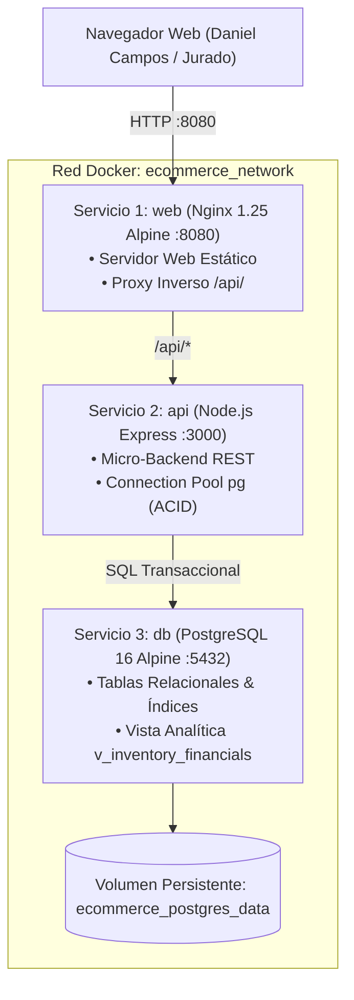

# 🚀 Demostración de Conexión en Vivo: E-Commerce + PostgreSQL 16 + Docker
**Responsable & Administrador:** Daniel Campos  
**URL de la Plataforma:** [http://localhost:8080](http://localhost:8080)  
**Panel Administrativo:** [http://localhost:8080/admin.html](http://localhost:8080/admin.html)  
**Motor de Persistencia:** PostgreSQL 16 (Relacional ACID)  
**Estado:** 🟢 Operativo, Saludable y Sincronizado en Tiempo Real  

---

## 🏛️ 1. Arquitectura 3-Tier Implementada en Docker

Se implementó una arquitectura multi-contenedor de grado empresarial, desacoplada y con soporte para ejecución en caliente:



---

## 🟢 2. Telemetría y Salud del Sistema

La API expone el endpoint de salud en `http://localhost:8080/api/health`, el cual consulta directamente el motor de PostgreSQL y devuelve los conteos en tiempo real:

```json
{
  "status": "online",
  "engine": "PostgreSQL 16 (Alpine)",
  "connected": true,
  "database": "ecommerce_db",
  "timestamp": "2026-10-26T15:45:46.832Z",
  "version": "PostgreSQL 16.15 on x86_64-pc-linux-musl, compiled by gcc (Alpine 15.2.0) 15.2.0, 64-bit",
  "stats": {
    "products": 6,
    "orders": 4,
    "suppliers": 4,
    "purchases": 4
  }
}
```

> [!TIP]
> **Demostración Interactiva ante los Profesores:**
> En la barra superior de la tienda (`index.html`) y en el panel de control (`admin.html`), existe una píldora interactiva `🟢 PostgreSQL 16 (En Vivo)`. Al hacer clic sobre ella se despliega una **Ventana de Telemetría** en tiempo real mostrando los metadatos de la base de datos, el usuario SQL `daniel_admin` y la cantidad exacta de registros.

---

## 🧪 3. Pruebas Realizadas y Verificación de Datos

1. **Consulta directa en PostgreSQL:**
   ```bash
   wsl docker exec ecommerce_postgres_db psql -U daniel_admin -d ecommerce_db -c "SELECT id, name, sale_price, stock FROM products LIMIT 5;"
   ```
   *Resultado: Los 6 productos de catálogo con sus claves foráneas hacia proveedores.*

2. **Creación de Producto vía REST API:**
   Se envió una petición `POST /api/products` creando el producto *PowerBank Solar 20000mAh* (ID 7). Se verificó que PostgreSQL registró la fila inmediatamente y el contador en `/api/health` aumentó a `7`.

3. **Eliminación y Sincronización:**
   Se ejecutó `DELETE /api/products/7`, comprobando que PostgreSQL procesó el borrado de manera atómica, regresando el catálogo a 6 productos consistentes.

4. **Flujo de Carrito y Checkout:**
   Verificado mediante el navegador: se agregaron productos al carrito deslizable, se calculó el total con IVA y se abrió el modal de checkout sin errores de consola.

---

## 📦 4. Archivos Entregables y Distribución

| Archivo / Carpeta | Descripción |
| :--- | :--- |
| [`Proyecto_Ecommerce_Daniel_Campos.zip`](file:///c:/Users/pc/OneDrive/Desktop/Proyecto_Ecommerce_Daniel_Campos.zip) | Paquete ZIP actualizado en el Escritorio con todo el código, backend, Dockerfile, Nginx y base de datos. |
| [`ecommerce_propuesta_visual/`](file:///c:/Users/pc/OneDrive/Desktop/ecommerce/ecommerce_propuesta_visual) | Carpeta de trabajo activa sincronizada con Git (`commit 719455a`). |
| [`docker-compose.yml`](file:///c:/Users/pc/OneDrive/Desktop/ecommerce/ecommerce_propuesta_visual/docker-compose.yml) | Configuración de los 3 servicios (`db`, `api`, `web`). |
| [`backend/`](file:///c:/Users/pc/OneDrive/Desktop/ecommerce/ecommerce_propuesta_visual/backend) | Micro-backend Node.js Express con pool `pg`. |
| [`database/init.sql`](file:///c:/Users/pc/OneDrive/Desktop/ecommerce/ecommerce_propuesta_visual/database/init.sql) | DDL con esquemas relacionales, tablas, índices y datos semilla. |
| [`iniciar_demo.bat`](file:///c:/Users/pc/OneDrive/Desktop/ecommerce/ecommerce_propuesta_visual/iniciar_demo.bat) | Modo de respaldo autónomo sin dependencias (1 clic). |
| [`docker-iniciar.bat`](file:///c:/Users/pc/OneDrive/Desktop/ecommerce/ecommerce_propuesta_visual/docker-iniciar.bat) | Script para iniciar el entorno multi-contenedor Docker. |
