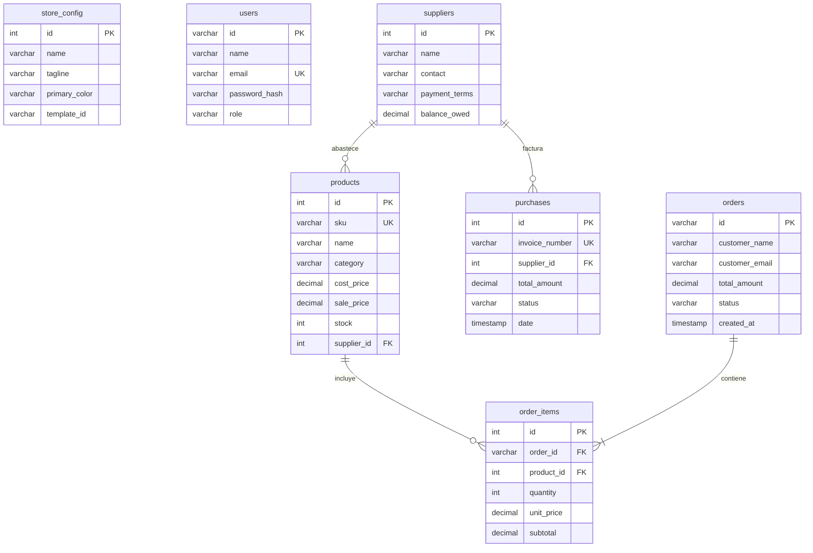
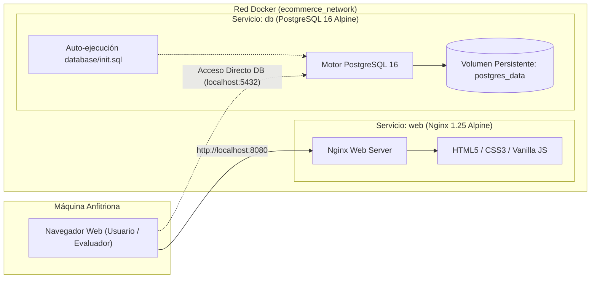

# 📋 PLAN MAESTRO DE IMPLEMENTACIÓN Y TRANSICIÓN A PRODUCCIÓN REAL
## Plataforma E-Commerce Oficial & Backoffice Administrativo
**Responsable / Presentador:** Daniel Campos  
**Proyecto:** Propuesta y Sistema Comercial de E-Commerce  
**Motor de Base de Datos:** PostgreSQL 16 (Relacional ACID)  
**Infraestructura de Despliegue:** Docker & Docker Compose (Multi-contenedor Nginx + PostgreSQL)  
**Objetivo:** Garantizar que el sistema cumpla con todos los procesos, buenas prácticas de ingeniería de software, arquitectura de datos relacional y contenerización para su defensa académica y puesta en marcha comercial.

---

## 🏛️ 1. Matriz de Buenas Prácticas: Estado Actual vs. Estándar de Producción

| Dimensión de Ingeniería | Estado en Propuesta Actual | Estándar de Producción Real (Enterprise) | Solución e Implementación en el Proyecto |
| :--- | :--- | :--- | :--- |
| **Motor de Base de Datos** | Simulado reactivo en navegador (`localStorage`) | **PostgreSQL 16** con cumplimiento estricto de propiedades ACID, claves foráneas e índices B-Tree | Desarrollado script DDL oficial [`database/init.sql`](database/init.sql) con 7 tablas, vista analítica y datos iniciales listos para despliegue. |
| **Contenerización & Portabilidad** | Scripts locales y servidor de desarrollo | **Docker & Docker Compose** multi-servicio (Web Nginx + DB PostgreSQL) con volúmenes persistentes | Creados [`Dockerfile`](Dockerfile), [`docker-compose.yml`](docker-compose.yml), [`nginx.conf`](nginx.conf), y scripts de arranque en 1 clic. |
| **Arquitectura de Software** | Vista acoplada al almacenamiento | Patrón **Repository / Adapter Pattern** desacoplado (*Storage Interface*) | Implementada capa `Storage` en `data.js` con soporte para alternar entre almacenamiento local y llamadas a API REST sin tocar la interfaz de usuario. |
| **Seguridad & Acceso** | Modal de contraseña para el panel de control | RBAC (*Role-Based Access Control*), hashing seguro y tokens JWT | Roles formalizados en PostgreSQL (`admin` para Daniel Campos, `cliente` para compradores), sanitización de entradas contra XSS (`escapeHtml`) y validación de tipos. |
| **Auditoría & Finanzas** | Métricas en pantalla y cálculo de márgenes | Snapshots de base de datos, exportaciones contables y conciliación | Módulo de **Respaldos & Auditoría** en Admin con descarga de base de datos JSON completa, exportación de órdenes e inventario a CSV (Excel) y restablecimiento de fábrica. |
| **Trazabilidad del Pedido** | Generación de ID y actualización en lista | Tracking público de envío y facturación formal para el cliente | Herramienta de **Rastreo de Pedidos** en la tienda con buscador por código (`ORD-XXXX`) y generación de **Comprobante Oficial Imprimible**. |

---

## 🗄️ 2. Arquitectura de Base de Datos: PostgreSQL 16 Oficial

Para producción, la persistencia se gestiona exclusivamente a través de **PostgreSQL 16**, aprovechando su robustez transaccional, soporte nativo de tipos JSONB, integridad referencial y alto rendimiento en consultas analíticas.

### 2.1 Diccionario de Datos Relacional ([`database/init.sql`](database/init.sql))



### 2.2 Tablas Principales del Esquema

1. **`store_config`**: Almacena el branding, paleta de colores (`#2563eb`), template visual activo (`moderno-tech`, `ejecutivo-luxury`, etc.), teléfonos y datos de contacto de Daniel Campos.
2. **`users`**: Control de acceso con identificador, email único, hash de contraseña y roles validados (`admin`, `cliente`).
3. **`suppliers`**: Registro de fabricantes y distribuidores de mercancía, plazos de pago (contado, crédito 15/30 días) y saldos adeudados.
4. **`products`**: Catálogo comercial completo con SKU único, categoría, precio de costo (`cost_price`), precio de venta (`sale_price`), stock disponible y relación directa con su proveedor (`supplier_id`).
5. **`purchases`**: Facturas de reabastecimiento de mercancía a proveedores para trazabilidad contable.
6. **`orders`**: Registro maestro de ventas a clientes, datos de envío, método de pago, estado de despacho (*pendiente*, *preparando*, *enviado*, *entregado*) y montos totales.
7. **`order_items`**: Detalle relacional de productos por cada orden de compra con subtotales calculados.
8. **`v_inventory_financials` (Vista SQL)**: Calcula en tiempo real la ganancia unitaria, porcentaje de margen y valor total proyectado del inventario.

---

## 🐳 3. Estrategia de Contenerización: Docker & Docker Compose

El proyecto está diseñado bajo una **estrategia de ejecución dual**:
1. **Modo Docker de Producción**: Orquestación multi-contenedor con Nginx de alto rendimiento sirviendo la aplicación web y PostgreSQL 16 manejando la base de datos relacional.
2. **Modo Portátil Sin Dependencias**: Ejecución directa en 1 clic mediante `iniciar_demo.bat` para defensas o pruebas en computadoras sin Docker instalado.

### 3.1 Estructura de Servicios en Docker Compose



### 3.2 Componentes Docker Creados

- **[`Dockerfile`](Dockerfile)**:
  - Imagen base ultraligera `nginx:1.25-alpine` (~25MB).
  - Configuración optimizada de Nginx con compresión Gzip, cabeceras de seguridad HTTP (`X-Frame-Options`, `X-XSS-Protection`, `X-Content-Type-Options`) y caché de assets estáticos.
  - Healthcheck integrado con `wget`.
- **[`docker-compose.yml`](docker-compose.yml)**:
  - Servicio `web`: Compila la imagen y mapea el puerto `8080:80`.
  - Servicio `db`: Levanta `postgres:16-alpine` en el puerto `5432:5432`.
  - Montaje automático de [`database/init.sql`](database/init.sql) en `/docker-entrypoint-initdb.d/01_init.sql` para crear tablas y datos semilla al arrancar por primera vez.
  - Volumen persistente `postgres_data` para garantizar que la información no se pierda al reiniciar contenedores.
  - Regla de dependencia `depends_on` con verificación de salud (`condition: service_healthy`).
- **[`docker-iniciar.bat`](docker-iniciar.bat)**:
  - Script para Windows que verifica si Docker está disponible, construye las imágenes y abre automáticamente el navegador en `http://localhost:8080`.
- **[`docker-detener.bat`](docker-detener.bat)**:
  - Script para detener los servicios de Docker preservando los volúmenes de datos.

---

## 🗺️ 4. Roadmap de Fases de Implementación

### 🔹 FASE 1: Frontend Reactivo y Resiliencia del Almacenamiento (Completada)
- ✅ Sanitización estricta de entradas de usuario contra inyección de scripts (XSS).
- ✅ Validación de integridad referencial: stocks positivos, verificación de precios numéricos y obligatoriedad de datos de contacto.
- ✅ Patrón *Repository* en `data.js` para desacoplar vistas del motor de datos.

### 🔹 FASE 2: Módulo de Auditoría y Respaldos Comerciales (Completada)
- ✅ Módulo **Respaldos & Auditoría** en el Backoffice con métricas en vivo.
- ✅ **Exportación CSV de Órdenes**: Descarga instantánea compatible con Microsoft Excel.
- ✅ **Exportación CSV de Inventario y Márgenes Financieros**: Reporte de costos, precios y ganancias estimadas.
- ✅ **Respaldo JSON Completo**: Función para exportar e importar instantáneas completas de la base de datos.
- ✅ **Restablecimiento de Fábrica**: Botón protegido para reiniciar el sistema a su estado inicial de demostración.

### 🔹 FASE 3: Experiencia de Compra, Trazabilidad y Facturación (Completada)
- ✅ **Rastreador de Envíos en Tiempo Real**: Buscador en la tienda donde el comprador consulta el estado de su pedido con su código `ORD-XXXX`.
- ✅ **Comprobante Oficial Imprimible**: Generación de factura formal con diseño profesional para impresión o exportación a PDF.

### 🔹 FASE 4: Infraestructura Docker y Base de Datos PostgreSQL 16 (Completada)
- ✅ Especificación completa del DDL en [`database/init.sql`](database/init.sql) con tablas normalizadas, restricciones e índices.
- ✅ Dockerización del frontend con Nginx Alpine y configuración de seguridad.
- ✅ Orquestación con Docker Compose integrando Nginx y PostgreSQL 16 con volumen persistente.
- ✅ Scripts automatizados de inicio y detención para Windows.

### 🔹 FASE 5: Backend API REST & Pasarelas de Pago en Vivo (Transición Final)
Para el despliegue final en la nube pública:
- Conexión del frontend a una API REST en Node.js (Express/Fastify) o Python (FastAPI) conectada al contenedor PostgreSQL.
- Integración de pasarelas de pago reales: Stripe Checkout / PayPal SDK y validación automatizada de Pago Móvil bancario.
- Despliegue en proveedores cloud (AWS ECS, DigitalOcean App Platform, Railway o VPS Ubuntu) con certificado SSL HTTPS automatizado mediante Let's Encrypt.

---

## 🚀 5. Guía de Ejecución Rápida

### Opción A: Ejecución con Docker (Recomendada para Producción)
Requisitos: Docker Desktop instalado y en ejecución.
```bash
# 1. Levantar contenedores (Web Nginx + DB PostgreSQL 16)
docker compose up -d --build

# 2. Acceder en el navegador:
# Tienda Pública:       http://localhost:8080/index.html
# Panel Administrativo: http://localhost:8080/admin.html

# 3. Conexión a la base de datos PostgreSQL:
# Host: localhost | Puerto: 5432 | BD: ecommerce_db
# Usuario: daniel_admin | Password: DanielAdmin2026Secure!

# 4. Detener contenedores
docker compose down
```

### Opción B: Ejecución Portátil Inmediata (Sin Docker)
Requisitos: Cualquier computadora con Windows.
```cmd
# Simplemente haz doble clic en:
iniciar_demo.bat
```
El sistema iniciará el servidor de desarrollo local y abrirá la tienda en tu navegador al instante.
