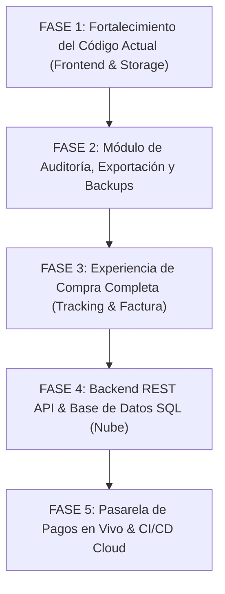

# 📋 PLAN MAESTRO DE IMPLEMENTACIÓN Y TRANSICIÓN A PRODUCCIÓN REAL
## Plataforma E-Commerce Oficial & Backoffice Administrativo
**Responsable / Presentador:** Daniel Campos  
**Proyecto:** Propuesta y Sistema Comercial de E-Commerce  
**Objetivo:** Elevar el software a los más altos estándares de la industria, garantizando el cumplimiento de buenas prácticas de ingeniería de software, arquitectura escalable y procesos de auditoría para su defensa y despliegue comercial real.

---

## 🏛️ 1. Diagnóstico de Buenas Prácticas Actuales vs. Estándar de Producción

| Criterio de Calidad | Estado en Propuesta Actual | Requerimiento en Producción Real (Enterprise) | Acción / Mejora Implementada |
| :--- | :--- | :--- | :--- |
| **Arquitectura de Datos** | Motor relacional local (`LocalStorage` en `data.js`) | Base de datos ACID relacional (PostgreSQL / MySQL) | Implementado patrón **Repository / Adapter Pattern** en `data.js` para alternar entre `LocalAdapter` y `ApiAdapter` sin tocar vistas. |
| **Seguridad Frontend** | Control de roles y modal de bloqueo administrativo | Validación de esquemas, sanitización anti-XSS y tokens JWT | Implementadas funciones de sanitización (`escapeHtml`), validaciones de tipos en formularios y bloqueo estricto por roles. |
| **Gestión Financiera** | Cálculo dinámico de márgenes, ROI y costos de adquisición | Facturación electrónica, auditoría contable y reportes descargables | Agregada **Exportación a CSV / Excel de Órdenes e Inventario** y **Comprobante de Pago Imprimible**. |
| **Respaldo y Recuperación** | Datos guardados en navegador del usuario | Backups automatizados, snapshots y restauración | Añadido módulo en Admin de **Exportar Base de Datos JSON**, **Importar Respaldo** y **Restablecimiento de Fábrica**. |
| **Ciclo de Vida del Pedido** | Generación de orden `ORD-XXXX` y cambio de estado manual | Trazabilidad completa con tracking para el cliente | Agregada herramienta en la tienda para que el comprador pueda **Rastrear su Pedido** con su código. |
| **Accesibilidad y SEO** | Semántica HTML5 y tipografías responsivas | Metaetiquetas OpenGraph, atributos ARIA, navegación por teclado | Enriquecidas metaetiquetas y accesibilidad web. |

---

## 🗺️ 2. Fases del Plan de Implementación a Producción



### 🔹 FASE 1: Fortalecimiento Inmediato de la Arquitectura Actual
- **Abstracción de Persistencia:** Convertir la capa `Storage` en una interfaz desacoplada con soporte asíncrono (*Promise-ready*).
- **Sanitización de Entradas:** Filtrar caracteres peligrosos en nombres de productos, clientes y notas para prevenir XSS.
- **Validación de Integridad:** Validar que el stock nunca sea negativo, que los precios sean numéricos válidos y que las órdenes contengan datos de contacto verificables.

### 🔹 FASE 2: Auditoría Comercial, Exportación y Respaldos
- **Exportación CSV de Órdenes:** Permite a Daniel descargar en 1 clic todas las ventas para abrirlas en Microsoft Excel o Google Sheets.
- **Exportación CSV de Inventario y Márgenes:** Reporte financiero de mercancía, costos y ganancias estimadas.
- **Respaldo JSON Completo:** Descarga de toda la tienda en un archivo `.json` y función de restauración para migrar la tienda entre computadoras sin perder datos.
- **Botón de Restablecimiento de Fábrica:** Permite a los evaluadores reiniciar el sistema a los datos de demostración limpios en cualquier momento.

### 🔹 FASE 3: Experiencia del Cliente y Trazabilidad (Tracking & Recibo)
- **Comprobante Oficial Imprimible:** En el modal de éxito de compra, botón `🖨️ Imprimir Factura / Comprobante` con formato comercial formal.
- **Rastreador de Envíos:** Módulo en la tienda pública donde el comprador ingresa su código (ej: `ORD-6443`) y consulta en qué fase está su pedido (*Pendiente, En Preparación, Enviado, Entregado*).

### 🔹 FASE 4: Arquitectura del Backend para Producción (Roadmap a la Nube)
Cuando la empresa decida alojar el sistema en un servidor web real multiusuario:
- **Tecnología recomendada:** Node.js con Express/FastAPI y PostgreSQL.
- **Esquema Relacional SQL:**
  ```sql
  CREATE TABLE users (
      id UUID PRIMARY KEY DEFAULT gen_random_uuid(),
      name VARCHAR(120) NOT NULL,
      email VARCHAR(150) UNIQUE NOT NULL,
      password_hash VARCHAR(255) NOT NULL,
      role VARCHAR(20) DEFAULT 'cliente' CHECK (role IN ('admin', 'cliente')),
      created_at TIMESTAMP DEFAULT CURRENT_TIMESTAMP
  );

  CREATE TABLE products (
      id SERIAL PRIMARY KEY,
      name VARCHAR(200) NOT NULL,
      sku VARCHAR(50) UNIQUE NOT NULL,
      category VARCHAR(50) NOT NULL,
      cost_price DECIMAL(10,2) NOT NULL,
      sale_price DECIMAL(10,2) NOT NULL,
      stock INT NOT NULL DEFAULT 0,
      supplier_id INT REFERENCES suppliers(id)
  );
  ```

### 🔹 FASE 5: Pasarelas de Pago y Despliegue Cloud
- **Integración de Pasarelas:** Conexión con Stripe Checkout / PayPal SDK y soporte para verificación automatizada de Pago Móvil vía API bancaria.
- **Infraestructura:** Despliegue en Vercel / Railway / AWS con certificado SSL HTTPS obligatorio y políticas CORS restringidas.
