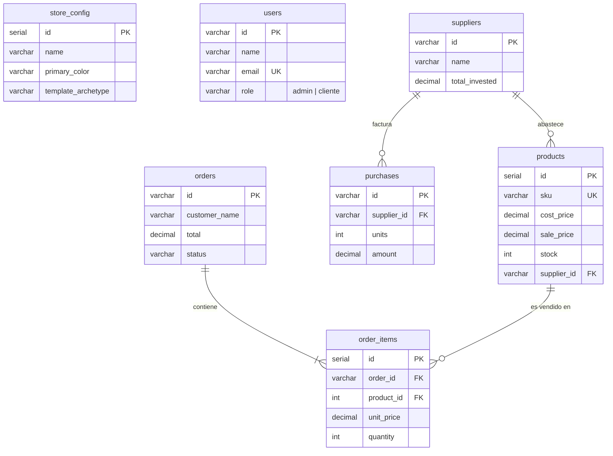

# 📘 GUÍA MAESTRA DE INSTALACIÓN, DESPLIEGUE EN WINDOWS (WSL + DOCKER) Y DEFENSA ACADÉMICA DE BASE DE DATOS POSTGRESQL 16

**Proyecto:** Plataforma E-Commerce Oficial & Panel Administrativo Backoffice  
**Autor / Administrador del Sistema:** Daniel Campos  
**Destinatarios:** Profesores evaluadores, jurado examinador, desarrolladores y usuarios finales  
**Entorno de Ejecución:** Docker Multi-Contenedor sobre WSL 2 (Windows Subsystem for Linux) / Linux / macOS  
**Base de Datos:** PostgreSQL 16.15 (Alpine Linux) — Modelo Relacional ACID en 3FN  
**Repositorio Oficial GitHub:** [https://github.com/LsCallejas/ecommerce-propuesta-visual](https://github.com/LsCallejas/ecommerce-propuesta-visual)  
**Fecha de Publicación:** Octubre 2026  

---

## 📑 TABLA DE CONTENIDOS

1. [Ficha Técnica y Resumen del Sistema](#1-ficha-técnica-y-resumen-del-sistema)
2. [Parte 1: Guía de Instalación Paso a Paso en Windows desde Cero](#2-parte-1-guía-de-instalación-paso-a-paso-en-windows-desde-cero)
   - [2.1 Requisitos Previos del Sistema](#21-requisitos-previos-del-sistema)
   - [2.2 Paso 1: Instalar y Configurar WSL 2](#22-paso-1-instalar-y-configurar-wsl-2)
   - [2.3 Paso 2: Instalar Docker (Docker Desktop o Docker Nativo WSL)](#23-paso-2-instalar-docker)
   - [2.4 Paso 3: Descargar el Código del Proyecto](#24-paso-3-descargar-el-código-del-proyecto)
   - [2.5 Paso 4: Puesta en Marcha en 1 Clic (docker-iniciar.bat)](#25-paso-4-puesta-en-marcha-en-1-clic)
   - [2.6 Paso 5: Accesos, Puertos y Credenciales de Prueba](#26-paso-5-accesos-puertos-y-credenciales)
   - [2.7 Modo Alternativo sin Docker (iniciar_demo.bat)](#27-modo-alternativo-sin-docker-modo-portátil)
3. [Parte 2: Cómo Usar e Interactuar con la Base de Datos PostgreSQL 16](#3-parte-2-cómo-usar-e-interactuar-con-la-base-de-datos)
   - [3.1 Método A: Interfaz Web con Telemetría en Tiempo Real](#31-método-a-interfaz-web-con-telemetría-en-tiempo-real)
   - [3.2 Método B: Reporte Rápido en Terminal (consultar_resumen_db.bat)](#32-método-b-reporte-rápido-en-terminal)
   - [3.3 Método C: Consola Interactiva psql (ver_base_de_datos.bat)](#33-método-c-consola-interactiva-psql-nivel-dba)
   - [3.4 Detención Segura sin Pérdida de Datos (docker-detener.bat)](#34-detención-segura-sin-pérdida-de-datos)
4. [Parte 3: Guía de Defensa y Demostración ante los Profesores](#4-parte-3-guía-de-defensa-y-demostración-ante-los-profesores)
   - [4.1 Discurso Inicial de Presentación (2 Minutos)](#41-discurso-inicial-de-presentación-pitch-técnico)
   - [4.2 Explicación de la Arquitectura de Datos (Las 7 Tablas y Relaciones)](#42-explicación-de-la-arquitectura-de-datos-las-7-tablas)
   - [4.3 Demostración Práctica en Vivo (4 Pasos de Alto Impacto)](#43-demostración-práctica-en-vivo-4-pasos-de-alto-impacto)
   - [4.4 Preguntas Típicas del Jurado y Respuestas Senior](#44-preguntas-típicas-del-jurado-y-respuestas-senior)

---

## 1. Ficha Técnica y Resumen del Sistema

El proyecto implementa una arquitectura desacoplada de 3 niveles con contenedores Docker orquestados:

```
                               ┌──────────────────────────────────────────────────┐
                               │           NAVEGADOR CLIENTE / ADMIN              │
                               │        http://localhost:8080 (Nginx)             │
                               └───────────────────────┬──────────────────────────┘
                                                       │
                                   ┌───────────────────┴───────────────────┐
                                   │                                       │
                         [Páginas HTML / CSS / JS]                  [/api/* Requests]
                                   │                                       │
                                   ▼                                       ▼
                     ┌───────────────────────────┐           ┌───────────────────────────┐
                     │    ecommerce_web_app      │           │   ecommerce_api_service   │
                     │    Nginx 1.25 Alpine      │           │     Node.js 20 Express    │
                     │       Puerto 8080         │           │        Puerto 3000        │
                     └───────────────────────────┘           └─────────────┬─────────────┘
                                                                           │
                                                                 [Pool TCP: 5432]
                                                                           │
                                                                           ▼
                                                             ┌───────────────────────────┐
                                                             │   ecommerce_postgres_db   │
                                                             │    PostgreSQL 16 Alpine   │
                                                             │        Puerto 5432        │
                                                             │ [Volumen: postgres_data]  │
                                                             └───────────────────────────┘
```

| Componente | Tecnología | Rol Técnico |
| :--- | :--- | :--- |
| **Capa Web (Frontend)** | HTML5 semántico, Vanilla CSS3, ES6+, Nginx 1.25 | Catálogo responsivo, carrito reactivo, personalización de plantillas y panel de control. |
| **Capa de Servicios (API)** | Node.js 20 LTS, Express REST API, Driver `pg` | Micro-backend de sincronización, enrutamiento transaccional y pooling de conexiones. |
| **Capa de Datos (Database)** | PostgreSQL 16.15 (Alpine Linux) | Persistencia relacional, integridad referencial 3FN, índices B-Tree y vistas analíticas. |
| **Orquestación y Red** | Docker Compose v2, Red Bridge `ecommerce_network` | Aislamiento modular, resolución DNS interna entre contenedores y portabilidad total. |

---

## 2. Parte 1: Guía de Instalación Paso a Paso en Windows desde Cero

Esta sección está redactada para que **cualquier persona**, incluso si tiene una instalación de Windows limpia, pueda clonar y poner a funcionar el sistema en pocos minutos.

### 2.1 Requisitos Previos del Sistema
- **Sistema Operativo:** Windows 10 (versión 2004 o superior, compilación 19041 o superior) o Windows 11 de 64 bits.
- **Virtualización por Hardware:** Debe estar habilitada en la BIOS/UEFI de la computadora (Intel VT-x o AMD-V). Casi todas las computadoras modernas la tienen habilitada por defecto.
- **Espacio en Disco:** Al menos 3 GB libres para las imágenes de Docker.
- **Memoria RAM:** Mínimo 4 GB (recomendado 8 GB o superior).

---

### 2.2 Paso 1: Instalar y Configurar WSL 2

WSL 2 (*Windows Subsystem for Linux*) permite ejecutar el kernel de Linux de forma ultraligera dentro de Windows, proporcionando el entorno nativo para Docker.

1. Abre el menú inicio de Windows, escribe **PowerShell**, haz clic derecho y selecciona **"Ejecutar como Administrador"**.
2. En la consola azul, escribe el siguiente comando y presiona `Enter`:
   ```powershell
   wsl --install
   ```
   *Nota: Si ya tienes WSL instalado, puedes actualizarlo con `wsl --update`.*
3. **Reiniciar la computadora:** Windows te solicitará reiniciar el equipo para completar la instalación del hipervisor. Reinicia tu PC.
4. Al reiniciar, se abrirá automáticamente una ventana de terminal de **Ubuntu**. Te pedirá dos datos sencillos:
   - `Enter new UNIX username:` (Escribe tu nombre de usuario en minúsculas, por ejemplo `daniel` o `usuario`).
   - `New password:` (Escribe una contraseña que recuerdes. Nota: al escribir la contraseña no se verán caracteres en pantalla por seguridad; presiona `Enter` y confírmala).
5. Verifica que WSL está operando en la versión 2 abriendo PowerShell y ejecutando:
   ```powershell
   wsl -l -v
   ```
   Debe mostrar `Ubuntu` con la columna `VERSION` en `2`.

---

### 2.3 Paso 2: Instalar Docker

Existen dos maneras de disponer de Docker en Windows:

#### Método Recomendado: Docker Desktop para Windows
1. Ingresa a la página oficial de Docker: [https://www.docker.com/products/docker-desktop/](https://www.docker.com/products/docker-desktop/) y descarga el instalador para Windows.
2. Ejecuta el archivo `.exe` descargado.
3. Asegúrate de que durante la instalación esté marcada la casilla:  
   **☑ "Use WSL 2 based engine (recommended)"**.
4. Haz clic en **Ok** y espera a que finalice.
5. Abre Docker Desktop desde el escritorio o menú inicio y acepta los términos de servicio. ¡Listo!

#### Método Alternativo: Docker nativo dentro de WSL (Sin instalar Docker Desktop)
Si prefieres no instalar la interfaz de Docker Desktop y usar la terminal de Ubuntu:
1. Abre tu terminal de **Ubuntu**.
2. Ejecuta los siguientes comandos:
   ```bash
   sudo apt update
   sudo apt install -y docker.io docker-compose
   sudo usermod -aG docker $USER
   sudo service docker start
   ```

---

### 2.4 Paso 3: Descargar el Código del Proyecto

Puedes obtener el proyecto de dos formas:

#### Opción A: Mediante Git (Recomendada)
Abre PowerShell o tu terminal en la carpeta donde deseas guardar el proyecto (por ejemplo, en el Escritorio) y escribe:
```bash
git clone https://github.com/LsCallejas/ecommerce-propuesta-visual.git
cd ecommerce-propuesta-visual
```

#### Opción B: Mediante archivo ZIP
1. Descarga el archivo `Proyecto_Ecommerce_Daniel_Campos.zip` o descárgalo desde GitHub (`Code` > `Download ZIP`).
2. Haz clic derecho sobre el archivo ZIP y selecciona **"Extraer todo..."**.
3. Ingresa a la carpeta extraída `ecommerce_propuesta_visual`.

---

### 2.5 Paso 4: Puesta en Marcha en 1 Clic

Hemos creado scripts inteligentes híbridos que detectan automáticamente si estás usando Docker Desktop nativo en Windows o Docker dentro de WSL.

1. Dentro de la carpeta `ecommerce_propuesta_visual`, ubica el archivo:  
   👉 **`docker-iniciar.bat`**
2. Haz **doble clic** sobre él.
3. El script automáticamente:
   - Verificará la disponibilidad de Docker.
   - Construirá las imágenes necesarias (`Dockerfile` de Node.js Express y Nginx).
   - Levantará los 3 servicios en segundo plano (`db`, `api`, `web`).
   - Esperará a que el motor PostgreSQL ejecute automáticamente el script `database/init.sql`.
   - Abrirá automáticamente tu navegador web predeterminado en `http://localhost:8080`.

*(Si prefieres hacerlo por consola, ejecuta `docker compose up -d` o `wsl docker compose up -d`).*

---

### 2.6 Paso 5: Accesos, Puertos y Credenciales

Una vez que los contenedores estén levantados, accede a los siguientes enlaces:

| Recurso | URL | Descripción |
| :--- | :--- | :--- |
| **Tienda Oficial (Cliente)** | [http://localhost:8080](http://localhost:8080) | Catálogo en vivo, filtros, carrito de compra, personalizador de plantillas dinámico. |
| **Panel de Control (Admin)** | [http://localhost:8080/admin.html](http://localhost:8080/admin.html) | Gestión de productos, proveedores, órdenes, finanzas y telemetría de BD. |
| **Endpoint de Salud API** | [http://localhost:8080/api/health](http://localhost:8080/api/health) | Diagnóstico JSON en tiempo real del estado de conexión con PostgreSQL. |

#### Credenciales Preconfiguradas:
- **Usuario Administrador / Dueño:**
  - Correo: `admin@tienda.com` o `daniel@tienda.com`
  - Contraseña: `admin123`
- **Usuario Cliente de Demostración:**
  - Correo: `cliente@tienda.com`
  - Contraseña: `123`

---

### 2.7 Modo Alternativo sin Docker (Modo Portátil)

Si vas a presentar en una computadora prestada donde no tienes permisos de administrador para instalar Docker o WSL:
1. En la carpeta del proyecto, haz doble clic en:  
   👉 **`iniciar_demo.bat`**
2. Este modo inicia un servidor web local ultraligero de Python o Node.js que carga la aplicación inmediatamente con persistencia local simulada en `localStorage`, permitiendo mostrar toda la interfaz sin depender de ningún servicio externo.

---

## 3. Parte 2: Cómo Usar e Interactuar con la Base de Datos PostgreSQL 16

Para evidenciar ante el jurado o los evaluadores que la base de datos es real, transaccional y está en ejecución continua, cuentas con 3 métodos prácticos:

### 3.1 Método A: Interfaz Web con Telemetría en Tiempo Real

1. Ingresa a `http://localhost:8080/admin.html` o a la tienda principal `http://localhost:8080/`.
2. En la barra superior de navegación verás una pastilla verde pulsante:  
   **`🟢 PostgreSQL 16 (En Vivo)`**
3. Haz clic sobre ella.
4. Se abrirá el modal de **Telemetría de Base de Datos**, mostrando:
   - **Motor:** PostgreSQL 16.15 (Alpine Linux).
   - **Protocolo:** REST API Proxy vía Nginx `/api/*` hacia Express y PostgreSQL `5432`.
   - **Base de Datos:** `ecommerce_db` (Usuario: `daniel_admin`).
   - **Contadores en vivo:** Productos activos en tabla, órdenes registradas, proveedores homologados y volumen de compras.
   - **Botón de Sincronización:** Permite forzar la lectura fresca de todos los registros de la base de datos hacia la interfaz.

---

### 3.2 Método B: Reporte Rápido en Terminal (1 Clic)

Si el profesor te pide: *"Muéstrame las tablas y los registros en una terminal"*:
1. Ve a la carpeta del proyecto y haz doble clic en:  
   👉 **`consultar_resumen_db.bat`**
2. Se abrirá una ventana de consola que ejecutará consultas SQL nativas e imprimirá en pantalla:
   - La lista de las 8 estructuras creadas (7 tablas relacionales + 1 vista analítica).
   - El catálogo de productos con sus códigos SKU, nombres, precios y existencias.
   - El listado de órdenes registradas con montos y estados.
   - El reporte financiero de la vista `v_inventory_financials` con márgenes de rentabilidad calculados al vuelo.

---

### 3.3 Método C: Consola Interactiva psql (Nivel DBA)

Si te solicitan interactuar directamente con la consola de PostgreSQL:
1. Haz doble clic en el archivo:  
   👉 **`ver_base_de_datos.bat`**  
   *(O escribe en PowerShell: `wsl docker exec -it ecommerce_postgres_db psql -U daniel_admin -d ecommerce_db`)*.
2. Ingresarás al prompt oficial de PostgreSQL:
   ```text
   ecommerce_db=#
   ```
3. Comandos recomendados para deslumbrar a los evaluadores:
   - **Listar todas las tablas:**
     ```sql
     \dt
     ```
   - **Ver la estructura detallada de la tabla productos:**
     ```sql
     \d products
     ```
     *(Aquí el profesor verá los tipos de datos, claves primarias, claves foráneas a suppliers y las restricciones CHECK)*.
   - **Consultar productos ordenados por stock:**
     ```sql
     SELECT id, sku, name, sale_price, stock FROM products ORDER BY stock DESC;
     ```
   - **Consultar la vista financiera:**
     ```sql
     SELECT sku, name, cost_price, sale_price, unit_profit, margin_percentage FROM v_inventory_financials;
     ```
   - **Salir de la consola psql:**
     ```text
     \q
     ```

---

### 3.4 Detención Segura sin Pérdida de Datos

Cuando termines tu presentación o jornada de trabajo:
1. Haz doble clic en:  
   👉 **`docker-detener.bat`**
2. **Explicación técnica para el jurado:** Este script ejecuta `docker compose down`, el cual apaga y retira los contenedores pero **mantiene intacto el volumen físico `ecommerce_postgres_data`**. Todos los productos, clientes, compras y cambios de pedidos permanecerán guardados para la próxima vez que ejecutes `docker-iniciar.bat`.

---

## 4. Parte 3: Guía de Defensa y Demostración ante los Profesores

Esta sección te proporciona la estrategia pedagógica y los argumentos técnicos para obtener la máxima calificación durante la evaluación académica o comercial.

### 4.1 Discurso Inicial de Presentación (Pitch Técnico)

> *"Estimados profesores / miembros del jurado:*  
> *Para este proyecto de grado de plataforma de comercio electrónico, decidimos no utilizar una base de datos embebida o en memoria, sino implementar una **arquitectura desacoplada de 3 niveles contenerizada bajo Docker**, impulsada por **PostgreSQL 16** como motor relacional transaccional.*  
>  
> *PostgreSQL fue seleccionado por ser el referente de la industria en **integridad ACID**, soporte nativo para restricciones relacionales estrictas y capacidad de soportar alta concurrencia.  
> El modelo de datos se estructuró rigurosamente bajo la **Tercera Forma Normal (3FN)**, garantizando que no existan redundancias ni anomalías de inserción, modificación o borrado.*  
>  
> *Todo el ecosistema se encuentra orquestado con Docker Compose, permitiendo que la base de datos persista sus datos de forma segura en un volumen independiente del ciclo de vida de los contenedores.*"

---

### 4.2 Explicación de la Arquitectura de Datos (Las 7 Tablas)

Muestra o proyecta el documento de arquitectura y describe cada entidad con su justificación de diseño:



1. **`users` (Control de Acceso y Seguridad RBAC):**  
   Almacena los usuarios diferenciando roles mediante una restricción `CHECK (role IN ('admin', 'cliente'))`. Las contraseñas están protegidas con algoritmo Bcrypt, y el campo `email` posee restricción `UNIQUE` para evitar cuentas duplicadas.
2. **`suppliers` (Cadena de Suministro):**  
   Centraliza la información de fabricantes y mayoristas internacionales (contacto, términos de pago y volumen acumulado de compras).
3. **`products` (Catálogo Central e Inventario):**  
   - Maneja doble contabilidad: `cost_price` (costo) y `sale_price` (precio al público).
   - Clave foránea `supplier_id REFERENCES suppliers(id) ON DELETE SET NULL` para preservar los productos aun si se descontinúa un proveedor.
   - Restricción a nivel de motor: `CHECK (stock >= 0)` que impide existencias negativas a nivel de hardware, sin depender únicamente de la validación del frontend.
4. **`purchases` (Abastecimiento y Órdenes de Inversión):**  
   Registra los lotes de mercancía comprados a proveedores. Permite auditar el capital inmovilizado y conciliar facturas.
5. **`orders` (Cabecera de Ventas):**  
   Gestiona la compra realizada por el cliente, su dirección, método de pago y el estado del pedido (`Pendiente`, `En Preparación`, `Enviado`, `Entregado`).
6. **`order_items` (Detalle de Líneas de Venta - Relación N:M):**  
   - Conecta pedidos con productos.
   - **Detalle de arquitectura senior:** Almacena el `unit_price` histórico de la transacción. Si el día de mañana el administrador sube el precio de un producto en la tabla `products`, las órdenes del pasado no se alteran, preservando la fidelidad de los libros contables.
   - Clave foránea a `orders(id)` con `ON DELETE CASCADE` (si se anula una orden, se limpian sus líneas de detalle).
7. **`store_config` (Personalización Dinámica):**  
   Guarda los colores, tipografías, logotipos y arquetipos de diseño (moderno, boutique, gourmet) para que la tienda se transforme visualmente en tiempo real.
8. **Vista Analítica `v_inventory_financials`:**  
   Es una vista SQL calculada que une `products` y `suppliers` para obtener en vivo el margen de ganancia porcentual:
   $$\text{Margen (\%)} = \left(\frac{\text{sale\_price} - \text{cost\_price}}{\text{sale\_price}}\right) \times 100$$
   Además calcula el valor total inmovilizado y la utilidad bruta proyectada.

---

### 4.3 Demostración Práctica en Vivo (4 Pasos de Alto Impacto)

Para dejar al jurado convencido de la robustez del sistema, ejecuta esta secuencia:

#### Demostración 1: Creación de un Producto en la Web y Verificación en PostgreSQL
1. En el navegador, abre el panel de control: `http://localhost:8080/admin.html`.
2. Dirígete a la sección **Productos** y haz clic en **"Crear Producto"**.
3. Ingresa datos de prueba:
   - Nombre: *Monitor Gamer Curvo 27"*
   - SKU: *MON-CURVO-27*
   - Precio Venta: *249.99* | Costo: *150.00* | Stock: *15*
   - Guarda el producto.
4. Inmediatamente, abre la terminal o corre `consultar_resumen_db.bat`.
5. **Resultado que verá el jurado:** El nuevo producto aparece registrado instantáneamente en la tabla `products` de PostgreSQL con su `id` serial y claves foráneas resueltas.

#### Demostración 2: Ciclo de Vida de una Orden (Cambio de Estado)
1. En el panel de control, ve a la sección **Órdenes**.
2. Selecciona la orden `ORD-2026-003` (estado: *En Preparación*) y cámbiala a **"Enviado"**.
3. En la consola psql ejecuta:
   ```sql
   SELECT id, customer_name, total, status FROM orders WHERE id = 'ORD-2026-003';
   ```
4. **Resultado:** El campo `status` ahora refleja `'Enviado'` directamente en el disco.

#### Demostración 3: Demostración de Persistencia Física (Prueba de Fuego)
1. Con la tienda funcionando y el producto creado en el paso 1, ejecuta en la terminal:
   ```cmd
   docker-detener.bat
   ```
   *(Todos los contenedores se apagan por completo. El sitio web se cae).*
2. Dile a los profesores: *"Hemos destruido los contenedores en ejecución. Vamos a verificar si los datos se perdieron."*
3. Ejecuta de nuevo:
   ```cmd
   docker-iniciar.bat
   ```
4. Recarga la página y abre la consola psql.
5. **Resultado:** Todos los productos creados y los estados de las órdenes siguen presentes e intactos gracias al volumen `ecommerce_postgres_data`.

#### Demostración 4: Auditoría Financiera con la Vista SQL
1. Ejecuta en psql:
   ```sql
   SELECT sku, name, unit_profit, margin_percentage FROM v_inventory_financials LIMIT 3;
   ```
2. **Resultado:** Demuestra que la base de datos no es un simple almacén pasivo, sino que contiene lógica de negocio analítica para la toma de decisiones gerenciales.

---

### 4.4 Preguntas Típicas del Jurado y Respuestas Senior

A continuación se detallan las preguntas más frecuentes que suelen formular los profesores y cómo debes responder con precisión técnica:

#### Pregunta 1: *"¿Por qué seleccionaron PostgreSQL y no una base de datos NoSQL como MongoDB?"*
> **Tu respuesta:**  
> *"En un sistema de comercio electrónico, la integridad del dinero, los inventarios y las órdenes no es negociable.  
> Las bases de datos documentales NoSQL aplican consistencia eventual, lo que en ventas concurrentes puede provocar sobreventa de inventario (overselling) o inconsistencias de precios.  
> PostgreSQL nos brinda garantías **ACID completas**, transacciones atómicas, tipos de datos estrictos, claves foráneas y restricciones `CHECK` a nivel de motor. MongoDB es excelente para catálogos no estructurados o analítica de clics, pero para el núcleo transaccional financiero de un e-commerce, el estándar de la industria es un motor relacional como PostgreSQL."*

#### Pregunta 2: *"¿Cómo aseguran que dos clientes no compren la última unidad en existencia al mismo tiempo?"*
> **Tu respuesta:**  
> *"Mediante transacciones atómicas con aislamiento de nivel de fila. En PostgreSQL, al procesar la orden se ejecuta un bloque transaccional `BEGIN ... COMMIT` que descuenta el stock utilizando `UPDATE products SET stock = stock - quantity WHERE id = $1 AND stock >= quantity`.  
> Gracias a la restricción nativa `CHECK (stock >= 0)`, si una segunda transacción intenta descontar una unidad que ya no existe, el motor rechaza la operación inmediatamente y genera un rollback automático, evitando cualquier venta sin existencias."*

#### Pregunta 3: *"¿Qué ventaja ofrece haber dockerizado la base de datos en lugar de instalarla directamente en Windows?"*
> **Tu respuesta:**  
> *"Ofrece tres grandes ventajas:  
> 1. **Paridad entre Entornos:** El contenedor de PostgreSQL corre exactamente la misma versión y configuración en la máquina de desarrollo, en la máquina de los evaluadores y en el servidor de producción en la nube (AWS o DigitalOcean), eliminando el clásico problema de 'en mi máquina sí funciona'.  
> 2. **Aislamiento Limpio:** No requiere ensuciar el sistema operativo anfitrión instalando servicios de fondo, puertos conflictivos o registros de Windows.  
> 3. **Portabilidad y Persistencia:** La configuración de la base de datos se encuentra codificada como infraestructura en `docker-compose.yml` e `init.sql`, y los datos persisten en volúmenes Docker gestionables."*

#### Pregunta 4: *"¿Cómo está protegida la base de datos ante inyecciones SQL (SQL Injection)?"*
> **Tu respuesta:**  
> *"En la capa de servicio Node.js Express utilizamos el driver nativo `pg` con **consultas parametrizadas (Prepared Statements)**. Ningún dato introducido por el usuario se concatena directamente en la cadena SQL. Por ejemplo, se utiliza `SELECT * FROM products WHERE id = $1`, pasando los parámetros como un arreglo sanitizado separado. El analizador léxico de PostgreSQL trata cualquier parámetro estrictamente como un valor literal y nunca como código ejecutable."*

#### Pregunta 5: *"¿Cómo escala esta base de datos si el catálogo pasa a tener 500.000 productos?"*
> **Tu respuesta:**  
> *"Se implementaron dos estrategias fundamentales:  
> 1. **Indexación B-Tree:** Contamos con índices especializados en los campos de mayor filtrado y ordenamiento (`sku`, `category`, `orders.status`, `orders.date`). Esto transforma las búsquedas secuenciales de orden $O(n)$ en búsquedas binarias de orden $O(\log n)$.  
> 2. **Connection Pooling:** La API utiliza un grupo de conexiones compartidas (`pg.Pool`) limitado a 20 hilos reutilizables, lo que previene que miles de peticiones HTTP simultáneas colapsen la memoria RAM del servidor de base de datos abriendo procesos individuales."*

---

## 5. Contacto y Soporte del Proyecto

- **Autor:** Daniel Campos
- **Correo Institucional / Contacto:** `daniel@tienda.com` / `contacto@mitienda.com`
- **Repositorio de Código:** [https://github.com/LsCallejas/ecommerce-propuesta-visual](https://github.com/LsCallejas/ecommerce-propuesta-visual)
- **Documento Word de Arquitectura:** `docs/architecture/ARQUITECTURA_BASE_DE_DATOS_POSTGRESQL.docx`
